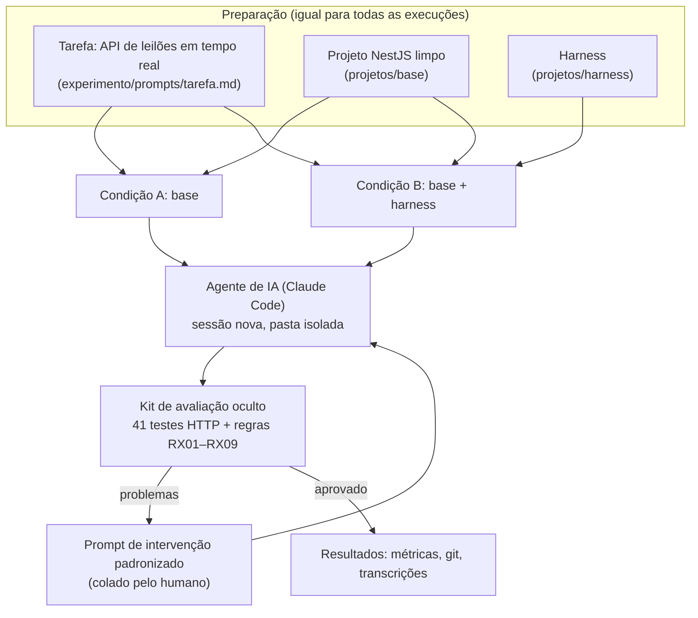

# 1. Visão geral

## O enunciado

> Construindo um Harness para agentes de IA. Prepare um repositório com instruções para agentes,
> regras arquiteturais, testes, lint e scripts de validação focado em Programação Reativa/Orientada
> a Eventos. Implemente a mesma funcionalidade com e sem o harness e compare a quantidade de erros,
> violações arquiteturais e intervenções humanas.

## O que é um *harness* para agentes de IA

Um agente de programação (Claude Code, Copilot, Cursor...) lê o repositório, edita arquivos e roda
comandos. Sozinho, ele segue o que "acha" melhor — normalmente o estilo mais comum nos dados de
treino, que para NestJS é o **imperativo** (estado em `Map`, `setTimeout`, um serviço chamando o
outro).

O **harness** é o conjunto de artefatos do repositório que **guia** e **verifica** o agente:

| Papel | Pergunta que responde | Neste projeto |
|---|---|---|
| **Guiar** (antes de escrever) | "Como este projeto quer que eu trabalhe?" | `AGENTS.md`, `CLAUDE.md`, `docs/arquitetura.md`, `docs/regras-reativas.md` |
| **Verificar** (depois de escrever) | "O que eu fiz está certo e dentro das regras?" | testes de contrato, lint, verificador de regras reativas, dependency-cruiser, verificador de estrutura, `npm run validate` |
| **Forçar o ciclo** (durante) | "Posso declarar que terminei?" | hooks do Claude Code: verificação a cada edição e bloqueio do encerramento enquanto a validação falhar |

A ideia central: o agente recebe **feedback automático e objetivo** do próprio repositório, em vez
de depender de um humano revisando e pedindo correções.

## Pergunta de pesquisa e hipóteses

**Pergunta:** um harness focado em programação reativa reduz os erros, as violações arquiteturais
e as intervenções humanas quando um agente de IA implementa uma funcionalidade orientada a eventos?

| Hipótese | Medida |
|---|---|
| **H1** — com harness, a primeira entrega tem menos erros | testes de aceitação ocultos falhando + build quebrado na 1ª entrega |
| **H2** — com harness, a primeira entrega tem menos violações arquiteturais | violações RX01–RX09 na 1ª entrega |
| **H3** — com harness, são necessárias menos intervenções humanas até a solução correta | prompts de correção + edições manuais + outras mensagens humanas |

Medidas exploratórias: tempo, chamadas de ferramenta, tokens, tamanho do código, testes escritos
pelo agente e atuação dos hooks.

## Como o experimento funciona (resumo)

- 3 execuções por condição (A1–A3, B1–B3), em ordem contrabalançada.
- O **kit de avaliação** é o mesmo para as duas condições e fica fora do alcance do agente.
- Toda alteração do agente vira commit; toda intervenção humana é contada; tudo é versionado.

## Mapa do repositório

| Pasta | Conteúdo |
|---|---|
| `projetos/base/` | projeto NestJS limpo (ponto de partida de A e B) |
| `projetos/harness/` | a camada de harness (aplicada por cima da base em B) |
| `experimento/` | tarefa, protocolo, registros e resultados das execuções |
| `avaliacao/` | kit de avaliação oculto: suíte de aceitação, avaliador, gabarito e anti-gabarito |
| `scripts/` | scripts de condução do experimento e de consolidação |
| `docs/` | esta documentação, decisões, linha do tempo e material para apresentação |

Próximo: [2. Fundamentação: programação reativa](02-fundamentacao-reativa.md).
