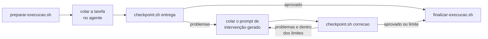

# Protocolo das execuções (roteiro passo a passo)

Este é o roteiro que **você** segue em cada uma das 6 execuções. Seguir exatamente os mesmos passos
em todas é o que torna a comparação justa e o experimento replicável.

- **Condição A (sem harness):** o agente recebe o projeto NestJS limpo + a tarefa.
- **Condição B (com harness):** o agente recebe o projeto NestJS + o harness + a **mesma** tarefa.
- **Ordem das execuções (contrabalançada):** `A1 → B1 → B2 → A2 → A3 → B3`.
  Intercalar as condições evita que o seu aprendizado ao longo do dia (ou mudanças no serviço do
  modelo) favoreça uma das condições.
- **Tempo estimado:** 20 a 60 minutos por execução. Dá para fazer em dias diferentes; só mantenha
  a configuração do Claude Code igual (passo 0).



---

## Passo 0 — Uma vez, antes da primeira execução

1. Rode o checklist de ambiente e corrija o que aparecer com ✖:

   ```bash
   scripts/verificar-ambiente.sh
   ```

   O item mais importante é o **Node visível para processos não interativos**. O agente e os hooks
   rodam comandos sem carregar o `~/.bashrc`; se o `npm` não for encontrado, o agente perde tempo
   (e você teria intervenções que nada têm a ver com o harness). A correção sugerida pelo script é:

   ```bash
   mkdir -p ~/.local/bin && ln -sf /usr/local/node-v24.9.0/bin/{node,npm,npx} ~/.local/bin/
   ```

   Depois disso, **feche e reabra o VS Code**.

2. Defina a configuração do Claude Code e **não mude mais até a última execução**:

   | Item | Como conferir | Recomendação |
   |---|---|---|
   | Modelo | `/model` na conversa | o mesmo nas 6 execuções (anote o nome exato) |
   | Esforço (effort) | seletor de esforço / `/effort` | o mesmo nas 6 execuções |
   | Modo de permissão | seletor de modo da extensão | o mesmo nas 6; `auto` evita pausas para aprovar comandos |
   | Instruções globais | `~/.claude/CLAUDE.md` | não criar/alterar durante o experimento |

3. Feche outras conversas do Claude Code abertas em outras pastas.

---

## Passo 1 — Preparar a execução

No terminal, na pasta do repositório principal (`Harness-agentes-IA`):

```bash
scripts/preparar-execucao.sh A1 --abrir
```

O script:

- monta o projeto em `~/projetos-leilao/A1` (base, ou base + harness para B), instala as
  dependências e cria um repositório git próprio com o commit inicial;
- cria `experimento/execucoes/A1/` com `execucao.json`, `registro.md` e `linha-do-tempo.md`;
- faz commit disso no repositório principal;
- com `--abrir`, abre a pasta em uma **nova janela** do VS Code.

> A pasta de trabalho fica **fora** do repositório principal de propósito: assim o agente não
> enxerga o kit de avaliação, o gabarito nem as outras execuções.

---

## Passo 2 — Iniciar o agente

Na **nova janela** do VS Code (a que abriu `~/projetos-leilao/A1`):

1. Abra o Claude Code e comece uma **conversa nova**.
2. Confira modelo, esforço e modo de permissão (passo 0) e anote em
   `experimento/execucoes/A1/registro.md`.
3. Nas execuções **B**, se o Claude Code perguntar se confia na pasta ou nos hooks do projeto,
   **aceite**: os hooks fazem parte do harness.
4. Abra `experimento/prompts/tarefa.md` (no repositório principal), copie **todo** o conteúdo e
   cole como **primeira mensagem**. Não acrescente nada. Anote o horário no registro.

---

## Passo 3 — Enquanto o agente trabalha (regras de conduta)

| Situação | O que fazer | Conta como intervenção? |
|---|---|---|
| O agente está trabalhando | **Não escreva nada.** Não rode comandos na pasta da execução. | — |
| Pede permissão para rodar um comando | Aprove. | Não (mas anote se for algo incomum) |
| Faz uma pergunta sobre os requisitos | Responda **exatamente**: `Siga a especificação da tarefa. O que não estiver especificado, decida você.` | Sim (contada automaticamente pela transcrição) |
| Para no meio e pergunta se deve continuar | Responda **exatamente**: `Continue até concluir a tarefa.` | Sim (idem) |
| Fica preso em loop por mais de ~10 min | Interrompa (Esc) e responda: `Continue até concluir a tarefa.` Anote no registro. | Sim |
| Você precisa editar código à mão (último recurso) | Edite, depois registre: `scripts/checkpoint.sh A1 humano "o que você mudou"` | Sim (edição manual) |

Nunca dê dicas, nunca diga o que está errado com suas palavras e nunca use o kit de avaliação
fora do `checkpoint.sh`. O único "feedback" que o agente recebe de você é o **prompt de intervenção
gerado pelo kit**, igual para A e B.

---

## Passo 4 — Registrar a entrega inicial

Quando o agente disser que terminou:

```bash
scripts/checkpoint.sh A1 entrega
```

O script faz commit do que o agente produziu (autor "Agente de IA"), roda o **kit de avaliação**
(≈30–40 s: build, tipos, lint, regras reativas, 41 testes ocultos 2× contra o servidor real) e
mostra o resultado:

- **✅ Critério de conclusão atingido** → vá para o passo 6.
- **✍ Intervenção** → vá para o passo 5. O prompt aparece no terminal e fica salvo em
  `experimento/execucoes/A1/checkpoints/01-entrega/intervencao.md`.

---

## Passo 5 — Intervenção (repetir enquanto houver problemas)

1. Abra o arquivo `intervencao.md` indicado, copie **todo** o conteúdo e cole como próxima
   mensagem **na mesma conversa** do agente. Não acrescente nada.
2. Espere o agente terminar.
3. Registre:

   ```bash
   scripts/checkpoint.sh A1 correcao
   ```

4. Repita até aparecer **✅** ou um dos limites:
   - **8 rodadas de correção**, ou
   - **120 minutos** desde a preparação.

   (Para ver de novo o último prompt: `node scripts/experimento.mjs prompt A1`.)

---

## Passo 6 — Finalizar

1. Complete o `experimento/execucoes/A1/registro.md` (observações e impressão geral).
2. Rode:

   ```bash
   scripts/finalizar-execucao.sh A1
   ```

   O script:
   - importa o histórico git da execução para o ramo `execucoes/A1` do repositório principal
     (com as tags `execucoes/A1/entrega` e `execucoes/A1/final`);
   - copia as transcrições do Claude Code (`~/.claude/projects/...`) para `experimento/execucoes/A1/sessao/`;
   - nas execuções B, copia o registro dos hooks (`harness-hooks.log`);
   - gera `resumo.json` e `resumo.md`, atualiza a linha do tempo e faz commit;
   - **apaga a pasta de trabalho** `~/projetos-leilao/A1` (o código continua no ramo). Use
     `--manter-pasta` se quiser mantê-la.
3. Feche a janela do VS Code da execução.

Para encerrar uma execução antes do critério (por exemplo, por um problema de ambiente):
`scripts/finalizar-execucao.sh A1 --motivo "descrição do motivo"`.

---

## Passo 7 — Depois das 6 execuções

```bash
node scripts/consolidar-resultados.mjs     # tabelas, CSV e gráficos em experimento/resultados/
scripts/gerar-historico-git.sh             # docs/historico-git.md
git add -A experimento/resultados docs && git commit -m "exp: resultados consolidados"
```

Para acompanhar o andamento a qualquer momento: `scripts/status-execucoes.sh`.

---

## Problemas comuns

| Problema | O que fazer |
|---|---|
| `preparar` recusa: "alterações não commitadas" | Faça commit no repositório principal (o estado do harness/kit usado precisa estar registrado). |
| O agente diz que `npm` não existe | Passo 0, item 1. Se acontecer no meio de uma execução, anote no registro. |
| O VS Code/Claude Code fechou no meio | Reabra a mesma pasta, retome a conversa (histórico de conversas da extensão) e anote no registro. |
| Registrei um checkpoint antes da hora | Não tente desfazer; anote no registro e siga o protocolo a partir dele. |
| O checkpoint mostra teste "intermitente" | É um teste que falhou em uma das 2 repetições: conta como falha (há bug de tempo/concorrência na implementação). |
