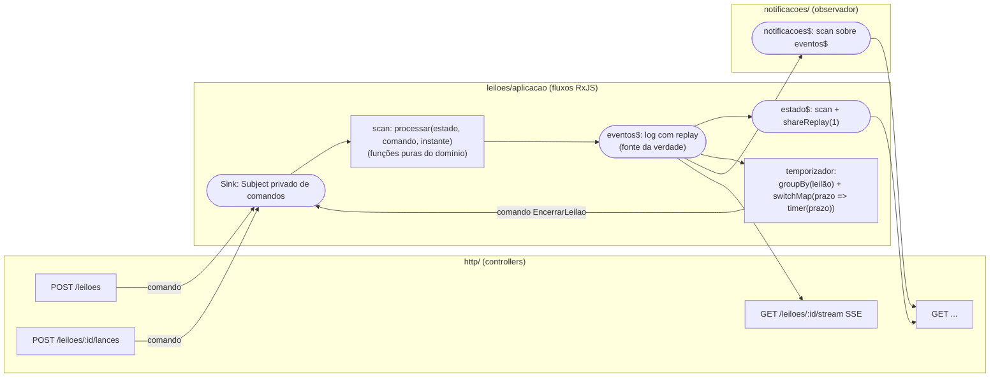

# Arquitetura

O sistema segue o paradigma **orientado a eventos / programação reativa**: em vez de um módulo
chamar setters de outro ("este muda esse"), cada módulo **publica eventos** e os interessados
**observam** o fluxo e se atualizam sozinhos (padrão *Observer*).

## Visão geral do fluxo



Correspondência com os conceitos da disciplina:

| Conceito | Neste projeto |
|---|---|
| **Sink** (entrada do stream) | `Subject` privado de comandos no serviço de aplicação |
| **Stream** (fluxo de dados) | `eventos$` (log de eventos) e suas projeções |
| **Controller** do stream | serviço de aplicação, dono do Sink (único que chama `next`) |
| **Listeners / observadores** | projeção de estado, notificações, temporizador, clientes SSE |
| **Operadores** (filter / transform) | `scan`, `filter`, `map`, `groupBy`, `switchMap`, `takeWhile`, `shareReplay`... |
| **Propagação de mudança** | um evento novo no log atualiza automaticamente todas as projeções |

## Camadas e dependências permitidas

Cada módulo (`leiloes`, `notificacoes`) tem três camadas:

| Camada | Contém | Pode importar |
|---|---|---|
| `dominio/` | tipos, eventos, comandos e **funções puras**: `decidir(estado, comando, instante) → eventos`, `evoluir(estado, evento) → estado`, redutores de projeções | apenas outros arquivos `dominio/` |
| `aplicacao/` | serviços `@Injectable()` com os **fluxos RxJS**: Sink, log, projeções, temporizadores | `dominio/`, RxJS, NestJS, `aplicacao/` de outro módulo (API pública) |
| `http/` | controllers e validação de entrada | `aplicacao/` e `dominio/` (tipos) |

Regras adicionais:

- `leiloes/` **nunca** importa `notificacoes/` (o emissor não conhece os observadores).
- Outros módulos só usam de `leiloes/` o serviço de `aplicacao/` (seus Observables públicos) e os tipos de `dominio/`.
- Sem dependências circulares.
- Configuração global (pipes, filtros) não vai no `main.ts`: os testes de contrato sobem o `AppModule` diretamente. Se precisar, use providers `APP_PIPE`/`APP_FILTER` no módulo.

Essas regras são verificadas por `npm run dependencias` (dependency-cruiser) e `npm run regras`.

## Padrões reativos recomendados

Os trechos abaixo são **genéricos** (nomes `Comando`, `Evento`, `Estado`); adapte ao domínio.

### 1. Sink privado + processamento sequencial com `scan`

```ts
@Injectable()
export class ExemploService implements OnModuleInit, OnModuleDestroy {
  private readonly entrada$ = new Subject<Entrada>();      // Sink: só este serviço chama next()
  private readonly destruir$ = new Subject<void>();

  // scan processa um comando por vez, na ordem de chegada (sem condições de corrida)
  private readonly processamento$ = this.entrada$.pipe(
    scan((anterior, entrada) => processar(anterior.estado, entrada), PROCESSAMENTO_INICIAL),
    share({ resetOnRefCountZero: false }),
  );

  // log de eventos: quem assinar depois recebe o histórico completo
  readonly eventos$ = this.processamento$.pipe(
    concatMap((p) => p.eventos),
    shareReplay({ bufferSize: Infinity, refCount: false }),
  );

  // projeção do estado atual
  readonly estado$ = this.processamento$.pipe(
    map((p) => p.estado),
    startWith(ESTADO_INICIAL),
    shareReplay({ bufferSize: 1, refCount: false }),
  );

  onModuleInit(): void {
    // conecta as projeções desde o início
    merge(this.eventos$, this.estado$).pipe(takeUntil(this.destruir$)).subscribe();
  }

  onModuleDestroy(): void {
    this.destruir$.next();
    this.destruir$.complete();
  }
}
```

### 2. Requisição/resposta sobre o fluxo de comandos

O controller precisa da resposta do *seu* comando. Assine o resultado **antes** de enviar:

```ts
executar(comando: Comando): Observable<Resultado> {
  return defer(() => {
    const entrada = { id: randomUUID(), comando, instante: Date.now() };
    const resultado$ = this.processamento$.pipe(
      first((p) => p.entradaId === entrada.id),
      map((p) => p.resultado),
    );
    const envio$ = defer(() => { this.entrada$.next(entrada); return EMPTY; });
    return merge(resultado$, envio$).pipe(take(1));
  });
}
```

### 3. Tempo como fluxo (prazo que pode mudar)

```ts
// Para cada entidade, reage ao prazo mais recente; switchMap cancela o timer anterior.
private readonly expiracoes$ = this.eventos$.pipe(
  groupBy((e) => e.entidadeId),
  mergeMap((grupo$) => grupo$.pipe(
    takeWhile((e) => e.tipo !== 'Finalizado'),
    filter(temPrazo),
    switchMap((e) => timer(new Date(e.dados.prazo))),
    map(() => comandoDeExpiracao(grupo$.key)),
  )),
);
// no onModuleInit: this.expiracoes$.pipe(concatMap((c) => this.executar(c)), takeUntil(this.destruir$)).subscribe();
```

### 4. Stream SSE = projeção filtrada do log

```ts
@Sse(':id/stream')
stream(@Param('id') id: string): Observable<MessageEvent> {
  return this.servico.eventos$.pipe(
    filter((e) => e.entidadeId === id),
    takeWhile((e) => e.tipo !== 'Finalizado', true),   // completa (fecha a conexão) após o último evento
    map((e) => ({ data: e })),
  );
}
```

> Para responder 404 antes de abrir o stream, o handler pode ser `async` e devolver `Promise<Observable<MessageEvent>>`.

### 5. Observador em outro módulo

```ts
@Injectable()
export class ObservadorService implements OnModuleInit, OnModuleDestroy {
  private readonly destruir$ = new Subject<void>();
  private readonly estado$: Observable<EstadoDoObservador>;

  constructor(emissor: EmissorService) {
    this.estado$ = emissor.eventos$.pipe(
      scan(reduzir, INICIAL),             // redutor puro (dominio/)
      startWith(INICIAL),
      shareReplay({ bufferSize: 1, refCount: false }),
    );
  }

  onModuleInit(): void {
    this.estado$.pipe(takeUntil(this.destruir$)).subscribe();
  }
  // ...
}
```

## Por que assim?

- **Consistência sob concorrência:** `scan` serializa os comandos; não há duas requisições alterando o mesmo objeto.
- **Rastreabilidade:** o log de eventos explica cada mudança de estado (e alimenta o histórico e o SSE de graça).
- **Baixo acoplamento:** novos observadores (ex.: estatísticas) entram sem tocar no módulo de leilões.
- **Testabilidade:** as regras de negócio são funções puras, testadas sem NestJS nem relógio real.
